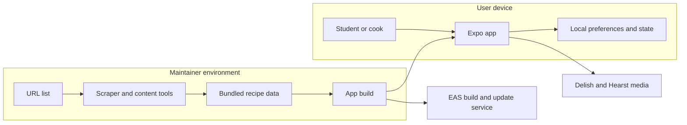

# Mobile App Project Threat Model

## Executive summary

This is a local-first recipe app intended for students and amateur cooks, with no sign-in, backend, or user-data collection reported by the owner. The main realistic risks are integrity risks in recipe and nutrition content imported from Delish, privacy/network exposure inherent in loading third-party images and videos, and unauthorized changes to the app or its over-the-air updates if maintainer accounts or release credentials are compromised. No direct unauthenticated app service or user-data exfiltration path was found in the reviewed runtime code. The app is not planned for public distribution, which reduces attacker reach and likelihood.

## Scope and assumptions

- In scope: the Expo/React Native app (`App.js`, `screens/`, `components/`, `context/`, `data/`), its EAS configuration, and the maintainer scraper/content tools (`scraper/`, `scripts/`).
- Out of scope: security of Delish/Hearst infrastructure, mobile OS internals, and account security beyond repository-visible EAS configuration.
- Owner-confirmed context: intended for students and amateur cooks; no public distribution planned; no sign-in; the app does not collect user data.
- Confirmed repository behavior: language choice is saved locally with AsyncStorage; favorites live in React state; recipes are bundled JSON; recipe images and videos use remote URLs; the scraper fetches Delish pages and writes recipe JSON.
- Assumptions: use is limited to a small, trusted student/amateur-cook audience; operators install a build they trust; no analytics, ad SDK, or backend is added outside this repository.
- Open questions that could change ranking: whether the app is actually distributed to student devices and how; whether EAS OTA updates are enabled for installed builds and who can publish them; whether “does not collect data” also excludes third-party media hosts receiving device IP address and media request metadata.

## System model

### Primary components

- **Mobile app:** Expo/React Native navigation and screens. Recipe browse, search, ingredient matching, favorites, timers, and language settings are local features. Evidence: `App.js` (`AppNavigation`, `toggleFavorite`), `screens/Home.js`, `screens/WhatCanIMake.js`.
- **Bundled content:** `data/recipes.json` and translation/caption JSON are imported by `data/recipes.js`; there is no runtime application API in reviewed source.
- **Third-party media:** recipe image and video URLs are loaded by React Native `Image` and Expo Video. Evidence: `screens/RecipeDetails.js`, `components/RecipeVideoPlayer.js`.
- **Maintainer tooling:** `scraper/scraper.js` fetches source pages and extracts JSON-LD recipe data; it writes `data/recipes.json`. `scripts/` contains translation/caption authoring tools.
- **Build/update service:** `app.json` configures an EAS Updates URL, and `eas.json` defines internal and production build profiles. The repo does not establish whether a production build is deployed or OTA updates are used.

### Data flows and trust boundaries

- Maintainer URL list (`scraper/urls.txt`) → scraper (`scraper/scraper.js`): page URLs are read from a local file; the script issues HTTPS requests via Axios and parses HTML/JSON-LD with Cheerio. Discovered recipe links are limited to `www.delish.com`, recipe-idea paths. No explicit response-size/time limits were found. The file and command line are operator-controlled, not app-user input.
- Delish pages → scraper → bundled recipe data: source content (titles, instructions, nutrition, image/video URLs) crosses an external-to-maintainer boundary. JSON parsing is guarded against invalid JSON, and image presence and video URL shape are checked, but a comprehensive schema/content/safety validation step was not found. The scraper writes output into the app’s imported JSON.
- App user → local app state: search text and ingredient selections filter bundled data; favorites are held in in-memory React state; language selection is restricted to `en` and `es` and persisted under `pantrypal.language` in AsyncStorage. No account/authentication boundary or app server is present in reviewed code.
- Device → image/video hosts: image and video requests use URLs from bundled recipe records (`screens/RecipeDetails.js`, `components/RecipeVideoPlayer.js`, `data/recipeVideo.js`). These requests use HTTPS in the sampled bundled records and generated video URLs; the app does not proxy them. A provider can receive the device network address and request metadata. No app-specific origin policy, host allowlist at runtime, or rate limit was found.
- Maintainer/build environment → EAS: `app.json` names the EAS update endpoint and project; build profiles include internal distribution and a production profile. Transport is configured with an HTTPS URL. Who can build/publish, signing protections, update channels, and actual deployment state are not verifiable from the repository.

#### Diagram

## Assets and security objectives

| Asset | Why it matters | Security objective (C/I/A) |
|---|---|---|
| Bundled recipes, nutrition, translations, and media URLs | Incorrect or altered instructions, allergy information, or nutrition may mislead a cook; changed URLs can direct the app to unintended hosts. | I, A |
| User device and local settings | Language is stored locally; favorites are in memory. Owner reports no collected user data. | C, I |
| App source, dependencies, and build artifacts | Unauthorized changes can affect every installed copy; malicious app updates can execute as the app. | I, A |
| Maintainer environment and EAS publishing access | Can alter recipe content or distribute an app/update to installed devices. | C, I, A |
| User network metadata | Third-party media requests reveal an IP address and access timing to the media provider even without app accounts. | C |

## Attacker model

### Capabilities

- A person with access to a shared/internal installation could use its ordinary local search, recipe, and media features.
- An attacker who compromises a maintainer workstation, content source, dependency, or EAS publishing credential could alter app content or an installed build/update.
- A third-party media host receives requests from devices when its remote media is loaded; this is a normal property of the current design, not evidence that the app itself stores or sells user data.

### Non-capabilities

- A remote attacker cannot directly submit requests to an app backend based on the reviewed repository: no backend or network listener was found.
- Ordinary app users cannot access another user’s account or cloud-stored favorites because no accounts or synced user records are present.
- The threat model does not assume an attacker can compromise a user’s device OS or bypass its app sandbox.
- Public-scale opportunistic attacks are less likely because the owner reports no public distribution. This assumption should be revisited if the app is shared broadly.

## Entry points and attack surfaces

| Surface | How reached | Trust boundary | Notes | Evidence (repo path / symbol) |
|---|---|---|---|---|
| Search and ingredient filters | Typing/selecting in local screens | User to local app | Values are used for local matching; no server request found. | `screens/Home.js`; `screens/WhatCanIMake.js` |
| Recipe details and bundled text | Selecting a recipe | Bundled content to UI | Instructions, ingredients, nutrition, and descriptions render from imported JSON. | `data/recipes.js` (`formatRecipe`); `screens/RecipeDetails.js` |
| Remote images and video | Opening recipe screens / playing video | Device to third-party host | App loads remote URLs directly; generated video URLs use Hearst media domain. | `screens/RecipeDetails.js`; `components/RecipeVideoPlayer.js`; `data/recipeVideo.js` (`getPlayableVideo`) |
| Language preference | Selecting English/Spanish | App to local device storage | Supported values are checked; read/write failures are handled. | `context/LanguageContext.js` (`setLanguage`, `LANGUAGE_STORAGE_KEY`) |
| Scraper input | Running scraper with local URL list | Maintainer to Internet and back | HTML and JSON-LD from Delish are parsed and written into app data. | `scraper/urls.txt`; `scraper/scraper.js` (`findRecipeLinks`, `scrapeRecipe`) |
| Build and OTA update configuration | Building or publishing through EAS | Maintainer/build system to installed app | Update endpoint is configured; authorization and publishing process are not in repo. | `app.json` (`updates.url`); `eas.json` (`build`) |

## Top abuse paths

1. **Poison recipe data:** attacker changes a source page or compromises content editing → maintainer refreshes data without noticing → misleading ingredient, allergy, instruction, or nutrition information is included in a build → a cook follows unsafe or unsuitable advice.
2. **Abuse remote media URLs:** attacker influences bundled recipe media URLs through a compromised source/content workflow → app requests attacker-controlled image or video content → attacker receives device request metadata and may exploit a media decoder vulnerability or disrupt playback.
3. **Compromise app publishing:** attacker obtains EAS publishing access or maintainer credentials → publishes a malicious or altered update/build → users who install or accept it run attacker-chosen app code.
4. **Exhaust or redirect maintainer scraping:** attacker changes the operator-controlled URL list or compromises a page/source → scraper follows discovered links and downloads large/slow responses → content refresh hangs, consumes resources, or produces incorrect output. The normal committed URL list is fixed and links are hostname-filtered, reducing remote reachability.
5. **Observe media usage:** media provider logs device IP and request timing when recipe images/video load → provider can infer that a device accessed particular content. This is network metadata exposure, not evidence of collection by the app owner.

## Threat model table

| Threat ID | Threat source | Prerequisites | Threat action | Impact | Impacted assets | Existing controls (evidence) | Gaps | Recommended mitigations | Detection ideas | Likelihood | Impact severity | Priority |
|---|---|---|---|---|---|---|---|---|---|---|---|---|
| TM-001 | Compromised or changed recipe source; malicious content contributor | Attacker must alter source content or gain access to the maintainer’s content workflow. A maintainer must refresh or accept the changed content. | Introduce inaccurate instructions, allergens, nutrition, or recipe metadata into the bundled dataset. | A student or amateur cook may make an unsafe or unsuitable recipe choice, especially if they rely on allergen or nutrition details. | Recipe data; user safety | Scraper fetches a fixed local URL list and limits discovered recipe links to `www.delish.com` recipe paths (`scraper/scraper.js`, `findRecipeLinks`). Nutrition values are copied only when provided by source; `scraper/README.md`. | Imported text/nutrition receives no demonstrated independent review or schema/safety check before use. Host filtering limits link discovery, not the integrity of the allowed source. | Keep scraping as a reviewed maintainer action; review diffs to `data/recipes.json` and source provenance before committing; validate required fields and flag unusual or missing ingredient/nutrition values; label nutrition/allergen information as source-provided and verify it before high-risk dietary use. | Review recipe-data diffs; record refresh date/source; manually spot-check instructions and nutrition changes before release. | Medium: requires source/workflow influence and maintainer acceptance, but the app is expressly content-driven. | Medium: incorrect food guidance can cause physical harm, though no evidence indicates an active malicious source. | medium |
| TM-002 | Compromised content source, content workflow, or third-party media host | Attacker must influence a URL in bundled recipe data or control a linked media host; user must load the affected recipe/media. | Cause the app to request attacker-chosen remote image/video content; expose request metadata or trigger a vulnerable native media/image decoder. | Device network metadata exposure, media disruption, or (if a relevant platform decoder flaw exists) compromise of the app process. | User network metadata; device; app availability | Scraper accepts only HTTP(S) video URLs with media-file extensions (`scraper/scraper.js`, `getRecipeVideos`); media is loaded by native Expo components. | Runtime `getPlayableVideo` checks extensions for direct stream URLs but does not enforce an HTTPS scheme or approved-host allowlist; recipe image URLs are rendered directly. No decoder vulnerability was confirmed. | Validate every imported image/video URL against HTTPS and an explicit host allowlist in the content pipeline; validate again before rendering; keep Expo and platform media components updated. Consider avoiding externally controlled media if source integrity cannot be assured. | Log/review host changes in data diffs; check dependency/platform security advisories during release review; investigate unexpected media-host changes or playback failures. | Low: attacker needs influence over bundled data or a linked host; distribution is limited. | High conditional: a decoder exploit could affect the device, but no such flaw was identified; metadata exposure alone is low impact. | medium |
| TM-003 | Attacker with maintainer/EAS credentials or build access | Attacker must compromise a maintainer account/workstation or obtain an authorized publishing credential. Installed users must install the altered build or receive its update. | Publish a malicious app build or OTA update. | Attacker code runs with the app’s device permissions and could alter displayed content or access data available to the app. | App artifacts; user device; local preferences | EAS updates endpoint and project are explicitly configured (`app.json`); app has no sign-in or backend in reviewed source. | Repository does not show publisher access controls, credential storage, update-channel policy, build approvals, or signing verification practices. Actual OTA use is unverified. | Restrict EAS project publishing to named maintainers with MFA; protect credentials and signing material; use reviewed release builds and separate development/production update channels; document who can publish and how releases are approved. | Review EAS publishing/build audit events; alert on unexpected production builds or update publication; verify release artifact provenance. | Low: requires account/workstation compromise; limited audience reduces exposure. | High: a malicious app update can execute code on installed devices. | medium |
| TM-004 | Malicious or compromised external page; operator-controlled URL input | Attacker must influence the local URL list or the response of a source page, and a maintainer must run the scraper. | Cause excessive or redirected network activity, slow/hang the scrape, or produce malformed content that flows into generated JSON. | Maintainer workflow disruption or poisoned bundled data; no server-side impact because the scraper is a local tool. | Maintainer workstation; recipe data integrity; build availability | URL list is local; discovered links require `www.delish.com` and recipe path constraints (`scraper/urls.txt`, `scraper/scraper.js`, `findRecipeLinks`). Invalid JSON-LD is ignored. | No explicit Axios timeout or response-size bound was found; response redirects and page content are not comprehensively constrained or validated. | Set request timeouts and response-size limits; disable or validate redirects against allowed hosts; validate parsed recipe objects before writing; run scraping in a low-privilege environment and review generated diffs. | Capture failed/slow request counts and rejected URLs; inspect generated JSON diff and file size before accepting refreshes. | Low: URL input is maintainer-controlled and the scraper is not an app entry point. | Medium: can disrupt content maintenance or integrity, but does not directly expose a deployed service. | low |
| TM-005 | Third-party media provider or network observer | User must view a recipe image or play a remote video. | Observe device IP address, request timing, and requested media URL. | A provider or network observer can infer that a device accessed specific recipe/media content. No account or identity linkage is shown in this app. | User network metadata; browsing privacy | Owner reports the app itself collects no data; no analytics SDK or app backend was found in the reviewed dependency/config/source surface. | Direct third-party media requests necessarily disclose network metadata to the provider; this is outside the app’s local state handling. Actual provider logging/retention was not verified. | Explain that remote media is loaded from third parties; where privacy is a requirement, proxy/cache media through a controlled service or bundle suitable assets locally. Avoid adding tracking SDKs without an explicit privacy review. | Review dependency and network destinations when adding packages/content sources; verify any provider privacy terms before broader use. | High: remote media requests occur during normal use. | Low: request metadata is exposed, but no direct identity or sensitive app data was found. | low |

## Criticality calibration

- **Critical:** credible path to broad compromise or severe harm across the user base. Examples: remotely exploitable code execution through routinely loaded media; an attacker publishing unsigned updates to all installed copies; a public service exposing sensitive student data. None is confirmed here.
- **High:** serious device or user harm, but with meaningful prerequisites or limited reach. Examples: malicious update to a small installed group; a confirmed exploitable native media flaw; recipe tampering that hides a serious allergen. No confirmed instance was found.
- **Medium:** plausible integrity or availability harm requiring maintainer/source influence. Examples: poisoned nutrition/instructions after an unreviewed refresh; compromised media URL reaching vulnerable player code; a compromised EAS publisher affecting internal users.
- **Low:** limited privacy or maintenance impact. Examples: media hosts learning IP/request timing; a scraper run failing or producing a rejected dataset without affecting installed app users.

## Focus paths for security review

| Path | Why it matters | Related Threat IDs |
|---|---|---|
| `data/recipes.json` | Bundled source of instructions, nutrition, and remote media URLs. | TM-001, TM-002 |
| `data/recipes.js` | Maps imported content into values rendered by the app. | TM-001, TM-002 |
| `data/recipeVideo.js` | Converts stored video records into playable remote URLs. | TM-002 |
| `screens/RecipeDetails.js` | Displays recipe text, nutrition, and remote images. | TM-001, TM-002 |
| `components/RecipeVideoPlayer.js` | Loads remote streams through Expo Video. | TM-002, TM-005 |
| `scraper/scraper.js` | Fetches and parses external pages, then writes the main recipe dataset. | TM-001, TM-004 |
| `scraper/urls.txt` | Operator-controlled source list for the scraper. | TM-004 |
| `scraper/package-lock.json` | Locks dependencies used by the content-fetching tool. | TM-004 |
| `app.json` | Defines EAS project and update endpoint. | TM-003 |
| `eas.json` | Defines internal/production build profiles; publisher controls are external to the repo. | TM-003 |
| `package-lock.json` | Locks app dependencies, including Expo updates and native media packages. | TM-002, TM-003 |

## Notes on use

- **Confirmed findings** are repository behavior described above or owner-provided context. The owner’s statement that the app collects no user data is accepted as context; static source review found no app backend or analytics SDK, but cannot observe runtime network traffic.
- **Assumptions** are limited internal use, maintainer control of refresh/build steps, and no external services beyond the visible media and EAS configuration.
- **Could not verify:** actual distribution size, EAS access controls and whether OTA updates are used, third-party media logging/retention, operating-system decoder patch status, and runtime network behavior on installed devices.
- Plain-language terms: **OTA update** means an app update sent over the network without a new store install; **allowlist** means a short list of hosts the app is permitted to contact; **JSON-LD** is structured recipe data embedded in web pages; **integrity** means keeping content and software accurate and unaltered.
- Quality check: app UI inputs, local storage, remote media, scraper inputs/source responses, and build/update configuration are covered; runtime app behavior is separated from maintainer tools; each identified boundary appears in at least one threat; user context and remaining assumptions are recorded.
